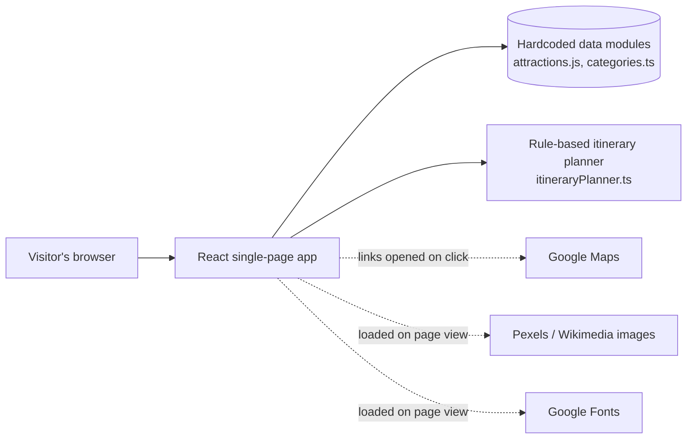

# Product Requirements Document (PRD)

## Beyond the Fort – The City of Music Nobody Hears

| | |
|---|---|
| **Product name (on site)** | Explore Gwalior — Beyond the Fort |
| **Team** | FRESH STACK, ABV-IIITM Gwalior (Information Technology + MBA, First Year) |
| **Event** | AI Synergy Hackathon 2026 |
| **Status** | Working prototype (front-end only) |
| **Live prototype** | https://explore-gwalior-tour-8ala.bolt.host |
| **Repository** | https://github.com/ab-hadi2528/explore-gwalior |
| **Document basis** | Source code review of the repository (latest commit `d91deb2`) |
| **Document date** | 14 October 2026 |

---

## 1. Overview

**Explore Gwalior** is a single-page tourism discovery website for Gwalior, Madhya Pradesh. It helps visitors find historical attractions and, in particular, the city's musical heritage, which is far less visible to tourists than the fort. Visitors can browse attractions by theme, build a suggested itinerary from their starting point, available time and interests, and open each attraction's details, map links, and verification status.

The product's distinguishing idea is **source-awareness**: every attraction record carries its sources, a "last verified" date, a verification status, and explicit warnings. Information that could not be confirmed is shown as *Not verified* instead of being guessed.

## 2. Problem Statement

Gwalior is widely associated with its fort, while its role as a centre of Indian classical music (the home of Tansen and the Gwalior musical tradition) is easy for a visitor to miss. Visitors planning a trip face three related problems:

1. **Low discoverability.** Musical and lesser-known heritage sites are overshadowed by the fort and are hard to find in a single place.
2. **Scattered and inconsistent information.** Opening hours, closing days and ticket prices are spread across official tourism pages, district pages and attraction websites, and these sources sometimes disagree. The dataset records such conflicts (for example, Jai Vilas Palace's timings and closing day).
3. **Hard to plan around personal constraints.** Visitors have limited time, a specific starting point and particular interests, and generic listings do not reflect these.

**This project proposes** a lightweight, honest discovery tool that organises Gwalior's attractions by theme, suggests a visit based on the visitor's inputs, and is transparent about what is and is not verified.

## 3. Goals and Non-Goals

### Goals
- Make Gwalior's historical **and** musical heritage easy to discover.
- Let visitors filter attractions by category and subcategory.
- Suggest an attraction list from starting point, available time and interests.
- Show verification status, sources and warnings for every attraction.
- Give one-click access to Google Maps for location, directions, nearby restaurants, hotels and parking.

### Non-Goals (current prototype)
- Ticket booking or payments.
- Guaranteed, travel-time-aware itineraries.
- User accounts, saved trips or personalisation across sessions.
- A backend, database, or live data feed.
- Runtime AI features (see Section 7).

## 4. Target Users

| User | Needs |
|---|---|
| **Short-stay tourists** (domestic and international) | Quick, trustworthy overview of what to see in a few hours. The dataset includes foreign-national pricing where known. |
| **Music and culture enthusiasts** | A direct route to musical heritage sites (Tansen's Tomb, Ghaus Mohammed's Tomb, Sarod Ghar Museum). |
| **Heritage and architecture visitors, students, photographers** | Context, highlights and significance for each site. |
| **Local information contributors** *(secondary)* | A way to flag incorrect details. The current report form is a demo only (see Section 8). |

## 5. Features

All features below exist in the current codebase.

| # | Feature | Description | Main files |
|---|---|---|---|
| 1 | **Landing hero and navigation** | Full-screen hero with call-to-action. Fixed navbar with smooth-scroll links and a mobile menu. | `Hero.tsx`, `Navbar.tsx` |
| 2 | **Explore by theme** | Three category cards (Historical & Architectural Heritage, Music & Culture, Spiritual & Scenic Places). Selecting one scrolls to the attraction list with that filter applied. | `ExploreCategories.tsx`, `categories.ts` |
| 3 | **Trip Discovery planner** | Visitor picks a starting location (Gwalior Railway Station, Gwalior Fort, Jai Vilas Palace), time (4, 6 or 8 hours) and optional interests (8 options, multi-select), then clicks *Find Places*. | `TripDiscovery.tsx`, `itineraryPlanner.ts` |
| 4 | **Suggested itinerary** | Lists matching attractions with duration, reason for recommendation, verification flags, uncertainty notes, a details button, and a Google Maps directions link from the chosen start. Warnings explain that travel times are not calculated. | `TripDiscovery.tsx`, `itineraryPlanner.ts` |
| 5 | **Attraction browser with filters** | Card grid of attractions with category and subcategory dropdowns, a verification status line, a warning badge where applicable, and an empty-state message when no results match. | `FeaturedAttractions.tsx`, `AttractionFilters.tsx` |
| 6 | **Attraction details modal** | Description, historical significance, map buttons (open in Google Maps, directions, nearby restaurants, hotels, parking), opening hours, closed days, ticket prices, official website and booking link, suggested duration, highlights, visitor interests, nearby facilities, and a verification section with sources and last-verified date. | `AttractionDetailsModal.tsx` |
| 7 | **Source-aware verification** | Each record has a verification status. The UI shows *Not verified* wording, a red warning for flagged records, an orange banner for conflicting timings, and a red banner for "potentially closed". | `attractions.js`, `AttractionDetailsModal.tsx` |
| 8 | **Report incorrect information** | Form with attraction, issue and optional contact fields. **Demo only; nothing is sent or stored** (see Section 8). | `ReportIncorrectInformation.tsx` |
| 9 | **Image fallback** | If an image fails to load, a placeholder with an "Image unavailable" message is shown instead. | `AttractionImage.tsx` |
| 10 | **About and footer** | Team, mission and values, project credits, and a reminder to confirm time-sensitive details with official sources. | `AboutUs.tsx`, `Footer.tsx` |

### 5.1 How the itinerary suggestion works

The planner is **rule-based** and runs entirely in the browser (`src/data/itineraryPlanner.ts`):

1. Start with all attractions except `sarod-ghar-museum`, which is excluded from itineraries because its operating status is unconfirmed. It still appears in the browse list.
2. Keep attractions that match the selected interests, using an interest-to-category map and a loose text match against each attraction's `visitorInterests`. With no interests selected, all remaining attractions are kept.
3. If nothing matches, fall back to the general list and show a warning.
4. For each attraction, look up an estimated visit duration from a fixed table of duration strings.
5. Attach a reason ("Recommended because you selected …") and uncertainty notes (unverified hours, unverified tickets, record warnings).
6. Add warnings: the count of attractions with unverified hours, and a notice that travel times are not calculated.

The starting location is used only for the summary text and the Google Maps directions link. It does not change which attractions are suggested or their order.

### 5.2 Dataset snapshot

The dataset (`src/data/attractions.js`) contains **9 attraction records**, last reviewed on **2026-10-13**:

| Attraction | Category | Verification status |
|---|---|---|
| Gwalior Fort | Historical | Partially verified |
| Jai Vilas Palace Museum | Historical | Partially verified; timings conflict between sources |
| Gujari Mahal Archaeological Museum | Historical | Partially verified |
| Sas Bahu Temples | Historical | Partially verified |
| Tansen's Tomb | Music & Culture | Partially verified; visitor details need confirmation |
| Ghaus Mohammed's Tomb | Music & Culture | Partially verified |
| Sarod Ghar Museum | Music & Culture | Potentially closed / current status unconfirmed |
| Sun Temple, Gwalior | Spiritual & Scenic | Partially verified |
| Tigra Dam | Spiritual & Scenic | Partially verified |

No record is marked fully verified. Sources cited include Incredible India, MP Tourism, the Gwalior district website, the Jai Vilas Palace website, the Ministry of Culture and the Ministry of Tourism.

## 6. Technology Stack

The stack below reflects what the code actually uses.

| Layer | Technology | Version (lockfile) | Notes |
|---|---|---|---|
| UI framework | React | 18.3.1 | Function components and hooks (`useState`, `useMemo`, `useEffect`) |
| Language | TypeScript and JavaScript | TS 5.6.3 | Components and planner logic in TypeScript. The dataset is a plain JavaScript module (`attractions.js`), cast to the `Attraction` type in `App.tsx`. |
| Build tool | Vite with `@vitejs/plugin-react` | 5.4.8 | `@/` alias maps to `src/` |
| Styling | Tailwind CSS, PostCSS, Autoprefixer | 3.4.17 | Custom palette: navy, sandstone, cream, gold |
| Icons | lucide-react | 0.446.0 | |
| Font | Poppins | n/a | Loaded from Google Fonts in `index.html` |
| Linting | ESLint and typescript-eslint | 9.12.0 | `npm run lint` |
| Hosting | Bolt hosting (`bolt.host`) | n/a | Live prototype URL |
| Development aid | Bolt.new (AI-assisted development) | n/a | Used to build the project; see Section 7 |
| Images | Pexels and Wikimedia Commons | n/a | Hotlinked by URL, not stored in the repo |
| Maps | Google Maps URL links | n/a | Plain links opened in a new tab. No Maps API, embedded map or API key. |

### 6.1 Architecture



The app is a static front-end. There is no server code, no API calls and no database.

### 6.2 Declared but unused

`@supabase/supabase-js` is listed in `package.json`, but it is **not imported or used anywhere** in the source. There is no Supabase client, no environment variables and no backend connection. It is not part of the working product.

### 6.3 Running locally

```bash
npm install
npm run dev        # development server
npm run build      # production build
npm run typecheck  # TypeScript check
npm run lint       # ESLint
```

## 7. Role of AI

AI was used **during development**: the project was built with AI assistance through Bolt.new.

The website itself contains **no runtime AI**. It makes no calls to a language model or any AI API. The "suggested itinerary" is deterministic, rule-based logic over a hardcoded dataset. AI-powered features are listed under Future Scope as proposals only.

## 8. Requirements

### 8.1 Functional requirements

| ID | Requirement | Status |
|---|---|---|
| FR-1 | The site presents attractions grouped into three categories and eight subcategories. | Implemented |
| FR-2 | Users can filter attractions by category and subcategory. | Implemented |
| FR-3 | Users can choose a starting location, available time and interests and receive suggestions. | Implemented (see Limitation L1) |
| FR-4 | Users can open a detail view for any attraction. | Implemented |
| FR-5 | Each attraction exposes Google Maps links for location, directions, restaurants, hotels and parking. | Implemented |
| FR-6 | Unverified or conflicting information is labelled, never presented as fact. | Implemented |
| FR-7 | Each record shows its sources and last-verified date. | Implemented |
| FR-8 | Users can submit a report about incorrect information. | **Partial.** The form works as a UI demo, but reports are not transmitted or stored. |
| FR-9 | Failed images degrade gracefully. | Implemented |

### 8.2 Non-functional requirements

| Area | Requirement and current state |
|---|---|
| **Responsiveness** | Mobile-first Tailwind layout with a collapsible mobile menu and a viewport meta tag. |
| **Performance** | Static single-page app; all attraction data is bundled, with no data-fetch calls. Remote images and the font load from third-party hosts. |
| **Privacy** | No user data is persisted or transmitted by the app (details in `COOKIES_AND_STORAGE.md`). |
| **Accessibility** | Partial: image alt text, `aria-label` on icon buttons, and an `aria-live` region for filter messages. The modal has no Escape-key handling or focus trap. |
| **Reliability of content** | Information is source-attributed, dated and clearly flagged when uncertain. |
| **SEO and sharing** | Page title, description, canonical URL, Open Graph and Twitter card tags are set in `index.html`. |
| **Maintainability** | TypeScript interfaces describe the data model (`attractionTypes.ts`). The project is split into small components. |

## 9. Limitations

**Known behaviour to be aware of:**

- **L1. Time-budget matching does not work as intended.** The planner reads the selected time as hours (4, 6 or 8) but compares it with visit durations in minutes. As a result, no stop ever counts as fitting the time budget. In testing the real function, every combination of time and interests returned **0 confirmed stops**, and all results appeared under *Additional Suggestions*. The attraction list and warnings still display correctly, but the "Confirmed Stops" section never appears.
- **L2. Starting location has no effect on results.** It only changes the summary text and the directions link. Stops are listed in dataset order.
- **L3. Travel time is not calculated.** The itinerary says so explicitly and points users to the Google Maps links.
- **L4. Report form does not save or send anything.** The success message reads "Report saved for this demo", but entered data exists only in browser memory and is lost on refresh.

**Scope and data limitations:**

- **Small dataset.** Nine attractions, hardcoded. Updating requires editing code and redeploying.
- **Incomplete verification.** No record is fully verified. Several records have no verified opening hours, and no record has a verified general ticket price (`value: null`). Visitors must confirm time-sensitive details with official sources.
- **No coordinates or embedded map.** All `coordinates` fields are `null`. Location features rely on Google Maps search links.
- **Images are hotlinked.** They depend on Pexels and Wikimedia availability. A fallback placeholder is shown on failure.
- **No audio or media.** Despite the music theme, the site does not play or embed any music.
- **No persistence or accounts.** Selections reset on refresh. Nothing is saved between visits.
- **English only.** No localisation.
- **Duplicated interest mapping.** The interest-to-category mapping exists in both `App.tsx` and `itineraryPlanner.ts`, with small differences, so list filtering and itinerary matching can diverge for some interests.
- **No automated tests** are present in the repository.
- **Prototype status.** As stated in the README, it does not provide ticket booking or guaranteed itineraries.

## 10. Future Scope

These are proposals and **not** current features.

**Near term (fix and finish)**
- Correct the hours/minutes unit mismatch so the time budget works (L1), and make the starting location influence ordering (L2).
- Make the report form functional with a real destination (a database or email service) and clearer wording about what happens to submissions.
- Verify opening hours, closing days and ticket prices with official sources, and add coordinates.
- Resolve the Jai Vilas Palace conflicting-timings and Sarod Ghar status records.
- Add Escape-key and focus handling to the details modal, and add automated tests.

**Medium term**
- Move data from a hardcoded file to a managed database. Supabase is already declared as a dependency and is one possible option.
- Add travel-time-aware routing and an embedded map.
- Add audio and video for the Gwalior musical tradition to deliver on the "city of music" theme, plus an events and festivals calendar.
- Add Hindi and other language support.
- Add an offline-capable (PWA) mode for visitors with limited connectivity.

**Longer term (AI Synergy direction)**
- A natural-language trip assistant that answers questions using only the verified dataset and shows its sources.
- AI-assisted checking of source pages to flag outdated or conflicting information for human review.
- Personalised itineraries, with explicit user consent for any stored preferences.
- Expansion to other cities using the same source-aware data model.

## 11. Success Criteria (Hackathon Prototype)

- A visitor can go from landing page to a suggested attraction list and detail view in a few clicks.
- Every displayed fact is either attributed to a source or labelled as unverified.
- Musical heritage is surfaced as a first-class category alongside historical heritage.
- The prototype runs with no backend and no data collection.

---

*Prepared by Team FRESH STACK for AI Synergy Hackathon 2026, IIIT Gwalior.*
